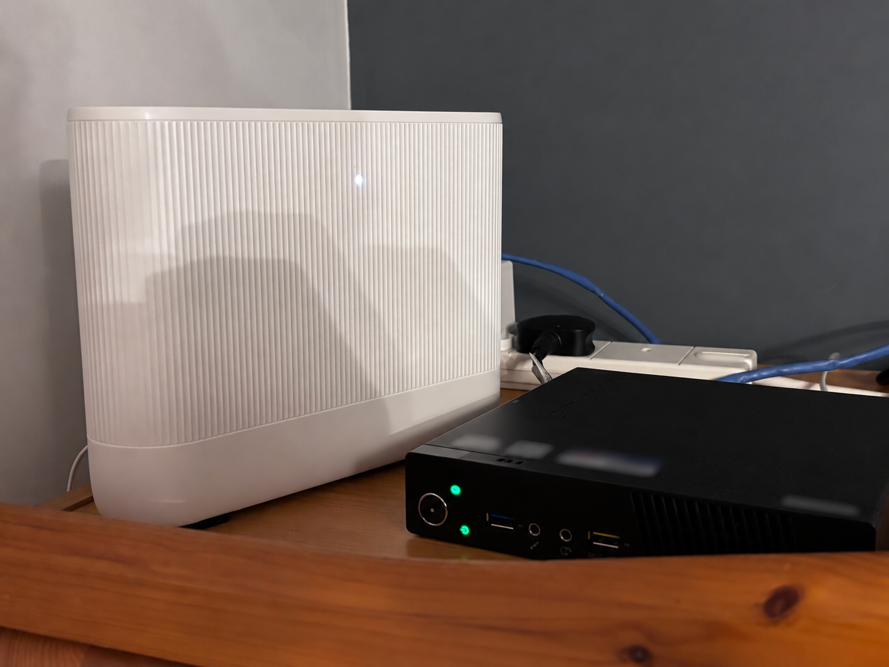
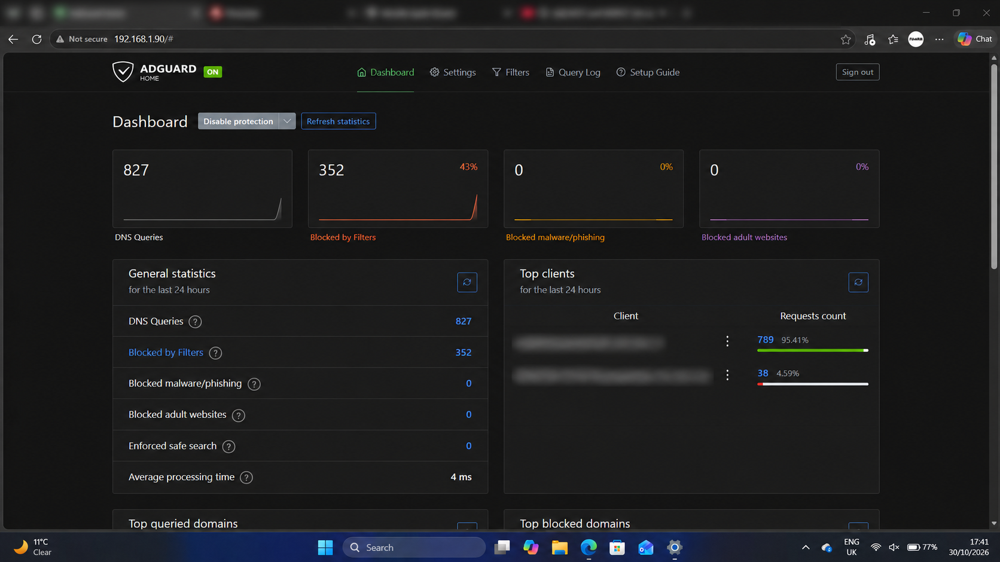
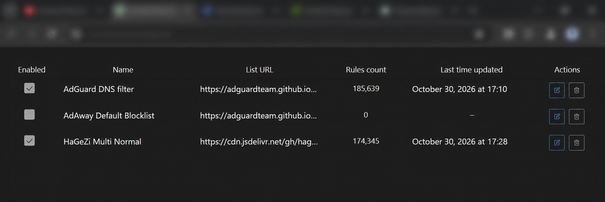
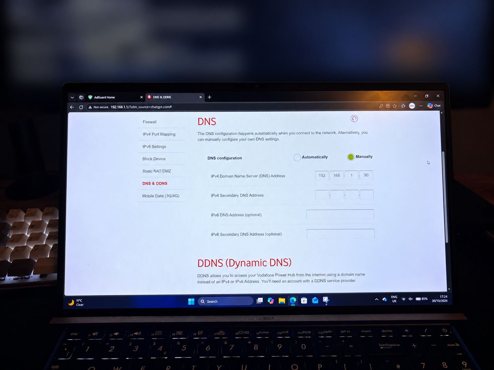

# Home Network DNS Ad-Blocking Server

A home-network DNS filtering project built on a Lenovo ThinkCentre M73 running Debian 13 and AdGuard Home. The server provides DNS filtering for devices that use the Vodafone Power Hub's DNS forwarding path.

## Project overview

The aim is to use existing hardware to run a dedicated DNS filtering service and make its activity visible through AdGuard Home. The current setup has two enabled filters: **AdGuard DNS Filter** and **HaGeZi Multi Normal**.

The figures in this repository are a record of the initial dashboard snapshot. They are point-in-time results, not a long-term average or a guarantee that every device or application is filtered.

## Hardware and software

| Component | Recorded details |
| --- | --- |
| Server | Lenovo ThinkCentre M73 |
| Processor | Intel Pentium (exact model not recorded) |
| Memory | 16 GB RAM |
| Storage | 1 TB HDD |
| Operating system | Debian 13 |
| DNS filtering | AdGuard Home v0.107.79 |
| Router | Vodafone Power Hub |
| AdGuard server address | `192.168.1.90` |
| Router address | `192.168.1.1` |
| Windows client address | `192.168.1.18` |

## Current network behavior

Other devices currently use DNS forwarded by the router. This documents the configured route; it does not claim that every device has been individually tested or that every DNS request is blocked. See the [network diagram](network-diagram.md) and [testing results](testing-results.md).

## Initial dashboard snapshot

| Dashboard measure | Initial value |
| --- | ---: |
| Queries | 827 |
| Blocked | 352 |
| Blocked share | 43% |
| Average processing time | 4 ms |

The screenshot shows 17:41 on 30 October 2026 in the Windows taskbar, and AdGuard Home labels its general statistics as covering the last 24 hours. This is one point-in-time observation, not a long-term performance claim. More context and limitations are in [testing results](testing-results.md).

## Repository contents

- [Network diagram](network-diagram.md) — Mermaid diagram of the documented DNS forwarding path.
- [Testing results](testing-results.md) — recorded dashboard values and what they do and do not establish.
- [Lessons learned](lessons-learned.md) — practical conclusions based on the documented setup and its current evidence.
- [Screenshots](screenshots/) — sanitized photos and configuration screenshots from the project.

## Screenshots

These images document the server hardware, AdGuard Home's initial dashboard, the enabled DNS blocklists, and the router's DNS configuration. Dashboard figures are point-in-time results; see [testing results](testing-results.md) for context.

### Server hardware

### Initial AdGuard Home dashboard

### Enabled blocklists

### Router DNS configuration

## Privacy

The included images are sanitized copies; the original files were left unchanged. Credentials, Wi-Fi details, MAC addresses, serial labels, public IP addresses, and device identities visible in the source images were excluded or obscured. The local RFC1918 addresses already documented in this repository remain visible where needed to explain the setup.

