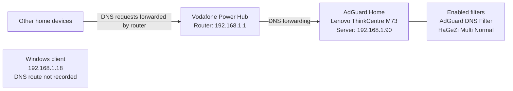

# Network diagram

This diagram records the current router-forwarded DNS path for other home devices. The Windows client address is documented separately because its exact resolver path was not recorded.

The diagram does not specify an upstream DNS provider because that detail was not recorded. It also does not imply that every device or application has been tested against the filtering server.

